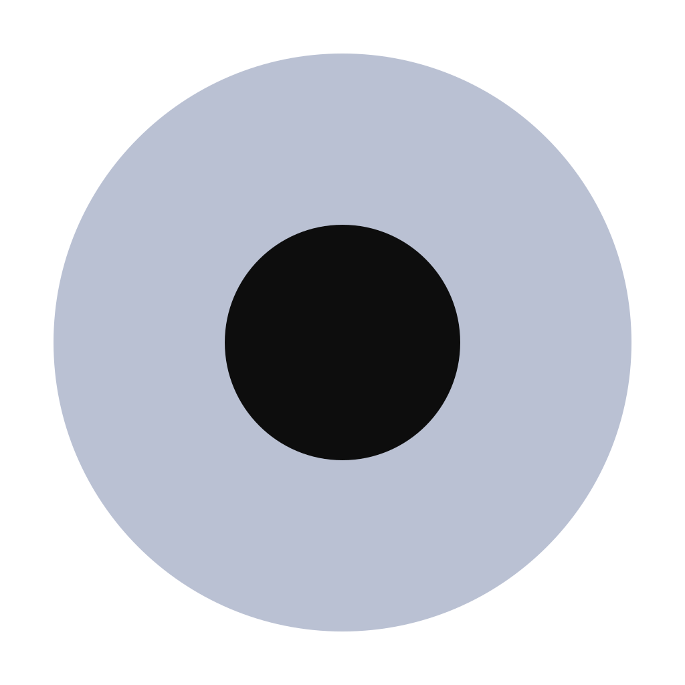

# FloatDot — Floating Desktop Widget for ChatGPT

**Your ChatGPT Dot, one click away.**

FloatDot keeps your ChatGPT Dot or conversation within reach in a tiny,
draggable desktop widget. Click the dot to open a compact ChatGPT window; click
the top bar to collapse it again. Use your existing ChatGPT account—no API key
required.

An independent, unofficial app. FloatDot is not affiliated with or endorsed by
OpenAI, and does not include a ChatGPT account or subscription.

[Get started](#get-started) · [Features](#features) · [Platforms](#platforms) ·
[FAQs](#frequently-asked-questions) · [Privacy](docs/PRIVACY.md) ·
[Support](#support-floatdot) · [License](#license)

## Features

- **A floating ChatGPT window:** keep the dot above ordinary desktop windows and
  open your selected conversation with a click.
- **Put it where you want:** drag the dot anywhere; its position is remembered
  independently of the expanded window.
- **Expand and collapse:** animated transitions respect reduced-motion
  preferences. In Live updates mode, the same page stays loaded.
- **Unread replies:** a badge indicates detected new assistant replies on your
  selected page while the dot is collapsed.
- **Choose your memory use:** Memory saver unloads an idle page after 60 seconds;
  Live updates keeps it loaded to continue checking for replies.
- **A familiar appearance:** the dot samples the visible avatar when available,
  with a lavender ring as its fallback.
- **Your own account:** sign in through ChatGPT's website and choose your own Dot
  or conversation. No API-key configuration or separate FloatDot account.
- **Windows system tray:** the floating dot stays visible, with a small tray
  icon instead of a regular taskbar button. Click the tray icon to open FloatDot;
  right-click it for Settings or Quit.

## Get started

FloatDot is an early desktop MVP. There is no published GitHub release yet.
Run it from source, or build an installer using the
[development guide](docs/DEVELOPMENT.md). When downloads are published, they
will appear on the [Releases page](https://github.com/M0hamedd/floatdot/releases).

Install Git and Node.js 24, then run:

```sh
git clone https://github.com/M0hamedd/floatdot.git
cd floatdot
npm ci
npm start
```

While the repository is private, you need access to clone it. On Windows, use
`npm.cmd` if PowerShell blocks `npm.ps1`. Dependency installation downloads
Electron; no separate frontend build is needed.

### Choose your Dot

1. Click the floating dot and sign in through ChatGPT's own login screen.
2. Navigate to the Dot or conversation you want to keep handy.
3. Click **Set current page as my Dot**. The setup row then disappears.
4. Click **Click to collapse** in the top bar to return to the floating dot.

### Controls

| Action | Control |
| --- | --- |
| Open the selected page | Click the dot |
| Collapse the window | Click the top bar or press **Esc** |
| Move the dot or window | Drag the dot or top bar |
| Open the menu | Right-click the dot or top bar |
| Toggle on Windows / Linux | **Ctrl+Shift+D** |
| Toggle on macOS | **Command+Shift+D** |
| Exit completely | Right-click → **Quit FloatDot** |
| Exit with keyboard / system Close | **Ctrl+Q** / **Command+Q**, or **Alt+F4** on Windows |
| Choose memory and badge behavior | Right-click → **Settings** |
| Open from the Windows tray | Click the FloatDot icon beside the clock |

Windows may initially place the tray icon in its **^** overflow area. You can
drag it beside the clock if you want it always visible.

The global toggle shortcut works when it is available on your system. Clicking
the top bar or pressing **Esc** collapses the window. An operating-system Close
command and **Quit FloatDot** stop the entire app.

### Memory settings

Right-click the dot or top bar and open **Settings**. Both choices explain their
tradeoff in the menu, and your selection is remembered:

- **Memory saver — lower RAM; badges pause after 60 seconds** (default): after
  one minute collapsed, an idle saved page unloads. The dot stays available;
  opening it reloads the page with your local sign-in storage intact. Unread
  detection pauses during sleep and does not count replies received while asleep.
- **Live updates — higher RAM; keeps checking for replies**: keeps the page
  running while collapsed for faster reopening and live unread detection.

Sleep waits while a sign-in popup, detected draft, attachment, response in
progress or audio is present. A page granted microphone/camera access remains
awake until a full page navigation or reload. Detection depends on ChatGPT's page markup.

## Platforms

| Platform | Current status | Build format |
| --- | --- | --- |
| Windows x64 | Interactive use and regression checks verified on Windows | `.exe` installer |
| macOS Intel / Apple silicon | Experimental; build configuration present, desktop testing pending | `.dmg` / `.zip` |
| Linux x64, X11 / XWayland | Experimental; build configuration present, desktop testing pending | `.AppImage` |

Native Wayland is unsupported; Wayland sessions need XWayland. Window behavior
can vary by desktop environment. Build success alone does not establish working
sign-in, transparency, dragging, or animation on a platform.

Developer builds are not ready for signed public distribution: Windows signing
is not configured, and macOS builds use ad-hoc signing without notarization.

## Frequently asked questions

### What is FloatDot?

FloatDot is an unofficial floating desktop widget for ChatGPT. It wraps the
ChatGPT website in a compact window you open from a small dot on your desktop.
It is useful when you want a ChatGPT conversation nearby while using other apps.

### Is this the official ChatGPT desktop app?

No. FloatDot is an independent project focused on a draggable dot, a compact
window, and unread indicators. It is not made by or endorsed by OpenAI.

### Do I need an API key?

No. FloatDot uses ChatGPT's website and your existing account. It does not call
the OpenAI API on your behalf or add API usage charges.

### Do I need a subscription or access to ChatGPT Dot?

You need whatever account access ChatGPT requires for the page you select.
FloatDot does not unlock unavailable features or include a subscription. A
regular ChatGPT conversation can also be selected.

### Does it work with my own account?

Yes. Each person signs in and selects their own page. The source and packaged
app contain no author's account, saved conversation URL, or login session.
People sharing an operating-system login also share the local browser profile.

### Does FloatDot stay on top of other windows?

The app requests an always-on-top window. Fullscreen apps, protected system
screens, and desktop-specific window rules can override that behavior.

### Does it notify me about every ChatGPT conversation?

No. The badge observes detected assistant replies on the selected, loaded page
while the dot is collapsed and ChatGPT is loaded. Opening FloatDot clears the badge. It is not an
account-wide notification service, and it cannot detect replies while quit.
In Memory saver mode it also cannot detect replies while asleep. Choose
**Settings → Live updates** if background badges are more important than RAM.
On a Dot page, ordinary chat replies, sidebar previews, and task-status changes
outside the Dot reply text are ignored.

Unread detection depends on website markup. Some edits, regenerations, or
virtualized history can be missed or miscounted. See the
[compatibility notes](docs/DEVELOPMENT.md#compatibility-and-verification).

### How do I change the saved Dot or conversation?

Right-click and choose **ChatGPT home / choose another conversation**. Navigate
to the page you want, then right-click the top bar and select **Set current page
as my Dot**. **Go to my Dot** returns to your saved page.

### Where are my chats, login, and preferences stored?

Your chats are handled by ChatGPT under its own service policies. Website
cookies and browser storage stay in a local Electron profile; the saved URL
and dot position are stored locally too. FloatDot has no separate backend or
added analytics service. See [Privacy and local data](docs/PRIVACY.md) for the
exact locations and what the app observes.

### Why is the dot lavender instead of matching my avatar?

Lavender is the fallback. Open your saved page and let the avatar load so the
app can sample it. Matching depends on the avatar being visible and the website
layout being recognized.

### Does it work offline, and does collapsing it save memory?

ChatGPT needs an internet connection. Memory saver unloads an idle saved page
after 60 seconds collapsed, which releases the page's renderer processes but
leaves FloatDot's own window and browser infrastructure running. Live updates
keeps the page alive and therefore uses more RAM. Choose **Quit FloatDot** to
stop all of the app's background processes.

### Why might sign-in or a feature stop working?

ChatGPT's website and identity providers can change or restrict embedded
browsers. FloatDot cannot bypass those restrictions or open app-only content
that has no accessible web page. Try **Reload page** from the menu and report
reproducible issues without including private chat content or credentials.

Only ChatGPT and the supported sign-in providers can open inside the widget.
Other HTTPS links open in your browser. Enterprise sign-in providers outside
the allowlist may not work. Microphone and camera access require your approval;
screen sharing and other sensitive browser permissions are currently disabled.

### Can I modify or share FloatDot? What about commercial use?

The source is available under **PolyForm Noncommercial 1.0.0**. Use,
modification, and sharing are permitted under the license's noncommercial
terms. Commercial use requires separate permission from the copyright holder.
The [full license](LICENSE.md) controls; it is not an unrestricted open-source
license. Contact [M0hamedd](https://github.com/M0hamedd) for commercial permission.

## Development and feedback

See the [development guide](docs/DEVELOPMENT.md) for builds, platform caveats,
architecture, and verification. Read [CONTRIBUTING.md](CONTRIBUTING.md) before
submitting a change.

For bugs or feature requests, [open an issue](https://github.com/M0hamedd/floatdot/issues)
with your operating system, app version, steps to reproduce, and expected
behavior. Remove conversation text, account details, and tokens from screenshots
and logs before attaching them.

## Support FloatDot

If FloatDot makes your day a little easier, you can
[support its development on Ko-fi](https://ko-fi.com/namelesscinder).
Donations are entirely optional and help with ongoing development and maintenance.

[](https://ko-fi.com/namelesscinder)

Sharing FloatDot, reporting bugs, and suggesting improvements also help. Thank you!

## License

Copyright (c) 2026 M0hamedd.

[PolyForm Noncommercial 1.0.0](LICENSE.md). Commercial use requires separate
permission. Third-party components retain their own licenses; see
[NOTICE.md](NOTICE.md).
